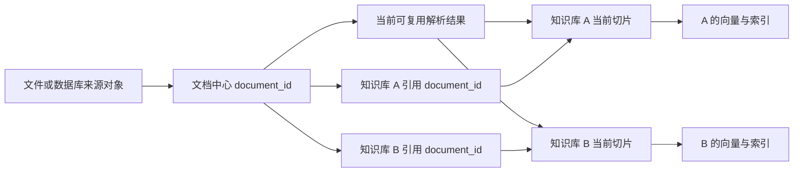

# RAG 文件与知识库管理：产品口径与本地 Demo 实现说明

更新日期：2026-09-07。

本文件统一说明文档中心、知识库引用、解析、切片、向量与索引的产品口径，并标明当前静态 Demo 与正式后端之间的差异。产品界面始终面向“当前最新版”；代码中的 `fileVersion`、`snapshot`、`chunkSet` 和 `indexGeneration` 是处理安全机制，不是运营人员可管理的版本产品。

## 1. 产品对象与归属

- 文档中心是文件类资料的统一来源，负责 `document_id`、当前原文件、来源、内容摘要、内部存储状态、处理状态以及被哪些知识库引用。存储状态用于后端判断原文件能否读取与恢复，不在运营列表中单独展示；前端只显示统一的当前处理“状态”。
- 知识库只保存对 `document_id` 的引用，以及该知识库当前生效的切片、向量和索引。知识库不复制一套用户可见的原文件，也不持有用户可选择的“文件版本”。
- 文件名只是展示字段，不是唯一键。系统允许多个文档重名，所有更新、删除和引用操作都必须使用 `document_id`。
- 同一文档在不同知识库可以使用不同的解析、切块和向量模型配置，因此 A、B 两个知识库可以同时拥有不同的当前切片结果。
- 同一知识库与同一 `document_id` 在任一时刻只允许一套当前生效切片。重切期间可以存在后台候选产物，但界面不提供多套切片选择。
- 当前生效切片需要持久化，并能在知识库详情或文件预览中按知识库查看。它不能只存在于任务日志或临时内存。

## 2. 当前最新版与内部快照

产品层不展示 `V1/V2`、文档版本、知识库版本、切片版本或索引代次，也不提供版本切换、历史版本下载和回滚入口。上传、列表、详情、资料选择和知识库文件行均只显示当前内容。

正式实现仍需要内部快照以保证处理安全：

1. 新内容先写入候选原文快照，生成 `content_hash`，但不立即覆盖当前生效的检索产物。
2. 解析、切片、向量化和索引都在候选任务或候选 generation 中完成。
3. 全链路成功后，系统原子切换当前原文/处理结果或知识库索引指针。
4. 候选失败或取消时不切换，当前可检索结果继续服务；失败候选可供短期排障与重试。
5. 成功切换后，旧原文、解析结果、切片、向量和索引标记为失效，并按清理策略删除。它们不作为长期产品化历史保存。

因此，“内部存在候选快照”不等于“产品支持多个版本”。内部 ID 只用于内容哈希判断、任务幂等、原子发布、失败恢复和并发保护。

当前静态 Demo 的 `fileVersions`、`parseResults`、`chunkSets`、`knowledgeVersions`、`embeddingRecords` 等对象仍用于模拟这些边界。部分失效对象会留在本次页面内存中，便于测试陈旧回调和失败恢复；正式后端应在安全窗口后清理或归档到不可见的审计存储，不能据此建设版本管理 UI。

## 3. 文件与数据库来源的身份规则

### 3.1 用户上传文件

- 浏览器上传对完整文件字节计算 SHA-256，作为 `file_hash`/`content_hash`。
- 已存在相同哈希时默认跳过，不重复保存原文，也不重复触发解析、切片或向量化。界面明确反馈“内容相同，已跳过”。
- 文件名相同、内容哈希不同时，不得自动覆盖。系统提示用户确认更新哪个 `document_id`；确认后沿用该 `document_id` 更新当前内容。由于文件名不是唯一键，用户也可以选择作为新的重名文档保存。
- 文件名不同但哈希相同仍按内容相同处理，默认复用已有文档；如业务必须保留独立来源关系，应新增来源引用，而不是重复存储相同字节。
- 更新过程中，旧知识库检索产物保持服务，引用该 `document_id` 的各知识库按自己的配置分别生成候选结果，成功后逐库原子切换。

### 3.2 数据库来源

- 数据库中的表、视图、查询结果或导出对象用稳定的 `source_object_key` 标识来源对象，不能以显示名称或导出文件名作为身份。
- 同步判定键为 `source_object_key + content_hash`：键与哈希都相同则跳过；来源对象相同但哈希变化则更新当前内容并触发受影响知识库的处理。
- Demo 中企业数据仍是 CSV 快照模拟。正式实现需要记录连接、库/schema、对象、抽取条件和同步时间，以构造稳定 `source_object_key`。

## 4. 两个入口汇入同一条链路

| 入口 | 资料选择 | 后续处理 |
|---|---|---|
| 文档管理 → 上传文档 | 直接上传并登记到公共池，不要求先选知识库 | 直接复用原第 3 步配置并提交解析；提交后返回列表，不生成公共池切片、向量或索引 |
| 知识库 → 添加资料 | 在“文档管理 / 企业数据”列表中选择，也可从来源工具栏右侧“上传文件”新增 | 当前知识库引用 `document_id`；新文件同步登记公共池，并按本库配置生成切片、向量和索引 |

资料选择阶段使用通用逐行列表组件，支持搜索、跨来源持续多选和数量汇总。列表行可快速预览当前原文或当前来源快照，用户无需先进入处理步骤才能核对资料。上传新文件是来源 Tab 同层最右侧的独立操作；上传结果同时进入文档中心。

文档管理的可见步骤条只显示“上传 → 解析”，但两页内容分别复用下表的第 2、3 步。其中第 3 步的字段、默认值与联动保持一致，只将主按钮改为“开始解析”并在提交后返回文档列表。不另设解析进度/完成页、动效或逐文件状态面板。

### 四步流程与触发时机

| 步骤 | 页面职责 | 任务触发 |
|---|---|---|
| 1. 定义知识库 | 名称、描述、向量模型 | 仅保存知识库基本信息 |
| 2. 选择资料 | 文档管理/企业数据列表、快速预览、独立上传 | 保存选择和导入批次，不解析 |
| 3. 文档解析 | 配置解析方法和识别内容 | 点击“下一步”时提交配置、启动异步解析，并明确提示“已开始解析” |
| 4. 文档处理 | 只配置切片方案及有效参数 | 点击确认并离开页面后，等待解析成功再生成切片；知识库流程随后向量化并写入索引 |

第 4 步不展示解析结果、解析预览、解析完成横幅或尚未生成的切片结果。解析仍在后台运行，用户可以先完成切片配置；若确认时解析尚未完成，切片任务排队等待。解析失败则任务进入失败状态，不发布候选切片。处理结果在任务区和知识库详情中查看。

预览不等于处理，也不会触发 Embedding。选择阶段的快速预览只读取当前已保存原文/快照；没有可预览内容时显示图标和状态文字。

## 5. 复用、增量与原子切换

- 解析复用要求 `content_hash + parser_id + parser_config_hash` 完全一致。
- 切片复用要求解析结果身份和 `chunk_config_hash` 一致。不同知识库切块配置不同就分别生成；配置相同也要建立各自的知识库引用和发布状态。
- 向量复用要求切片内容、完整编码输入、模型 ID、模型版本和维度一致。文档中心处理完成后不自动向量化，因为向量模型属于知识库索引契约。
- 新增或修改少量切片时，可以只重算受影响切片及其相邻上下文并增量更新索引；修改解析器、切片规则、向量模型或大量源内容时，应建立完整候选 generation 后整体切换。
- “重建索引”只重建当前知识库的检索结构。编码签名一致时复用已有向量；模型或编码输入变化时才重新向量化。
- 不支持安全增量的索引后端必须整库构建候选索引，再原子切换别名/指针，不能先清空当前索引。
- 任意候选失败、取消或被新任务取代，都不能覆盖当前 active 指针。成功切换后旧产物进入 obsolete/cleanup；当前知识库与当前文档仍只有一套 active 切片。

## 6. 操作影响范围

| 操作 | 删除或更新 | 必须保留 |
|---|---|---|
| 从知识库移除文档 | 当前库的文档引用、当前切片、向量、索引记录和相关任务 | 文档中心原文件、其他知识库结果 |
| 删除知识库 | 该库全部引用、切片、向量、索引和同步任务 | 文档中心原文件、其他知识库结果 |
| 删除文档中心文档 | 当前原文件和文档侧处理产物 | 有知识库引用时阻止删除，先解除引用 |
| 更新文档内容 | 当前原文及引用库的处理链路 | 各库旧 active 结果保持到候选成功切换；失败不切换 |
| 重新切块 | 当前库该文档的切片、向量与索引投影 | 原文件、其他知识库结果；重切成功前保留旧 active |
| 编辑标签 | 当前库元数据和过滤字段 | 编码输入未变时复用向量，只更新元数据索引 |
| 修改 Top K 或 Rerank | 查询时配置 | 原文、解析、切片、向量和内容索引 |

删除知识库不删除文档中心的文档。它删除的不只是 chunk，还包括该库对应的向量、全文/向量索引记录和未完成同步任务。

## 7. 路由与实现边界

产品路径使用稳定业务 ID：

- 文档列表：`#/local-documents`
- 文档上传：`#/local-documents/upload?step=upload`
- 文档详情：`#/local-documents/<document_id>`，需要查看某库当前切片时附加 `knowledgeBaseId=<kb_id>`
- 知识库导入：`#/knowledge/<kb_id>/import?step=upload`
- 批次恢复：附加 `batch=<batch_id>` 和当前步骤；批次 ID 不代表产品版本。

产品链接不携带用户可选择的 `fileVersionId`、`chunkSetId` 或 `knowledgeVersionId`。当前 Demo 若仍读取历史查询参数，只用于兼容旧书签和内部测试，不得在界面生成新的版本路径。

页面路由、浏览器 blob URL 和对象存储 key 是三类不同信息。路由定位业务对象；blob URL 只供本地临时预览；正式存储路径由后端用不可猜测的对象 key 管理，不能把文件名当路径或主键。

当前仍为静态前端 Demo：

- 文件、任务和候选对象保存在页面内存中，刷新恢复预置数据。
- TXT 等可读文本可执行本地解析/切块；PDF、OCR、语义切块、向量化和索引大多是状态模拟。
- 未连接真实对象存储、MinerU、任务队列、Embedding 服务、向量数据库和数据库增量同步。
- 物理清理、审计保留期、分布式原子切换、幂等锁和大规模增量能力需要正式后端实现。

## 8. 验收原则

- 任一产品页面均不出现 `V1/V2`、文档版本、知识库版本或切片版本选择。
- 重名文档可以并存；所有动作以 ID 定位，同哈希默认跳过，同名异哈希必须确认更新或另存。
- 文档中心是唯一文件来源；知识库只引用 `document_id`。
- 同一知识库与文档只有一套 active 切片，不同知识库可有不同切片。
- 候选失败不切换，成功后才原子发布，并清理或失效旧产物。
- 第 2 步支持快速预览；第 3 步点击下一步启动解析并反馈；第 4 步不显示解析结果或完成横幅。
- 当前切片持久保存，并能在知识库详情完整预览；未完成或失败候选不进入检索范围。
